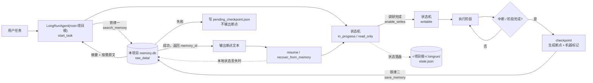
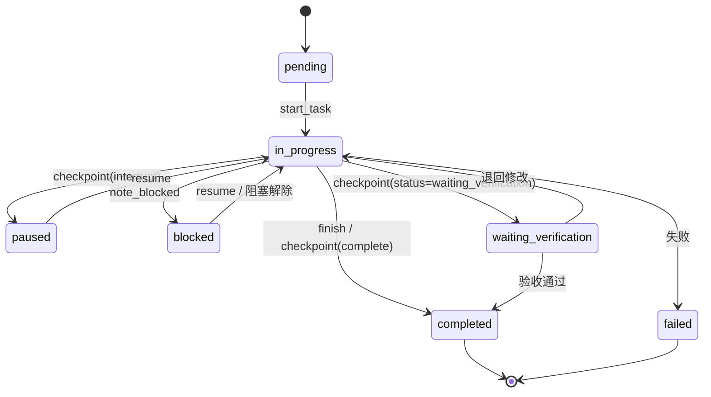
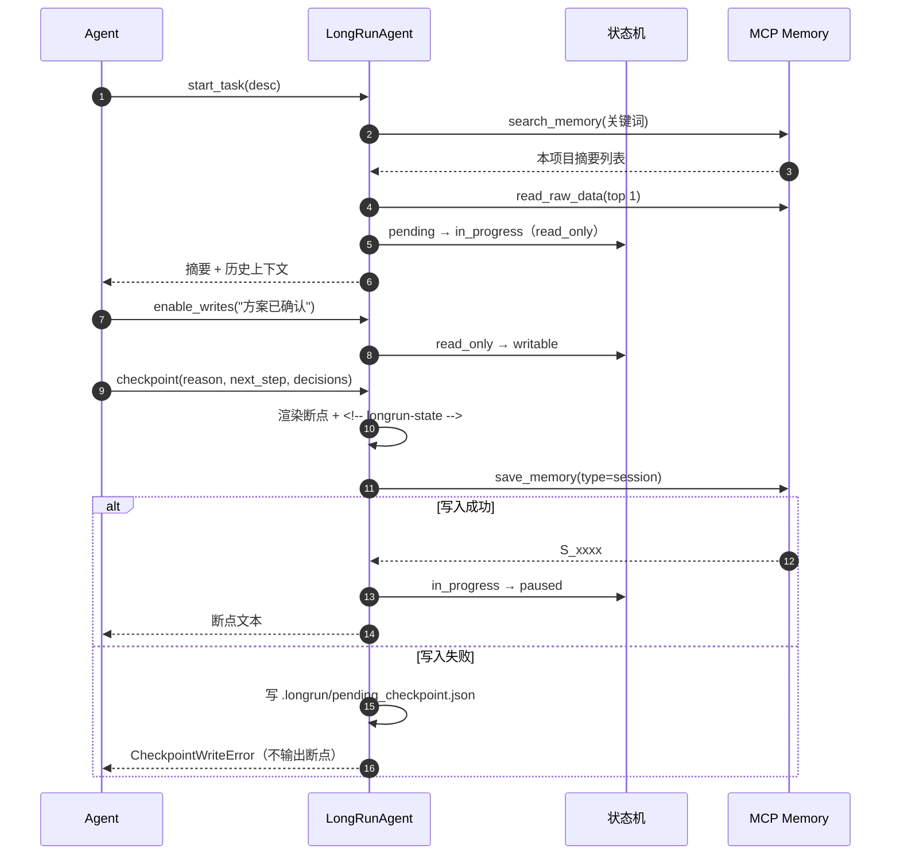

# Agent-LongRun-Framework v2

把「Agent 执行状态机」和「MCP 记忆路由」耦合成一条可中断、可恢复、可审计的长任务流水线。

任务开始先查记忆 → 执行受状态机与读写门禁约束 → 中断/阶段完成时先写记忆，再输出断点。

> 不是又一个 Agent 框架。没有 LLM 调用、没有编排 DSL，只有一层很薄的胶水：
> 让「执行」和「记忆」互为前提。
>
> v2 起，状态与记忆都绑定到**当前项目根目录**：`<项目>/.longrun/` + `<项目>/memory.db`，
> 不同项目互不串味。

## 解决什么问题

| 只有状态机 | 只有记忆 | 两者耦合（本框架） |
|------------|----------|--------------------|
| 断点存在本地，换机器就丢 | 记忆里有进度，但没人约束何时读写 | 本地热状态 + 记忆冷备份，互为恢复路径 |
| 可以随意跳状态 | 可以随意覆盖进度 | 非法流转失败，未完成任务不可覆盖 |
| 不记录为什么这么做 | 只记结果，不记执行边界 | 决策、阶段、门禁状态一起归档 |

## 架构



`LongRunAgent(root=...)` 同时决定两件事：

- 热状态写到 `<root>/.longrun/`
- 默认 `MCPMemoryBackend` 以 `--project_path <root>` 启动，记忆写到 `<root>/memory.db`

因此 `resume()` 读到的状态和记忆永远属于同一个项目。

### 执行状态机



### 一次断点的时序



## 快速开始

把两个仓库放在同级目录（默认会在这里找记忆路由器）：

```text
D:/
├── agent-memory-router-v2/
└── Agent-LongRun-Framework-v2/
```

```bash
git clone https://github.com/lss486558354-ship-it/agent-memory-router-v2.git
git clone https://github.com/lss486558354-ship-it/Agent-LongRun-Framework-v2.git

cd Agent-LongRun-Framework-v2
python -m pip install -e ".[dev]"
python -m pip install -e ../agent-memory-router-v2

python -m pytest tests/ -q                    # 42 passed
python examples/01_interrupted_task.py        # 本地后端
python examples/01_interrupted_task.py --mcp  # 真实 MCP stdio
```

路由器不在同级目录时，用环境变量指定：

```bash
export AGENT_MEMORY_ROUTER_PATH=D:/agent-memory-router-v2
```

> `MEMORY_ROUTER_HOME` 仍作为旧版兼容入口保留，但 v2 推荐直接用
> `LongRunAgent(root=...)` / `MCPMemoryBackend(project_path=...)`。

### 在真实项目里启用

```bash
cd D:/my-project
agent-projects init
```

这会在项目根目录生成 `.mcp.json`、`.cursorrules`、skill、`.gitignore`，
并创建 `memory.db` / `raw_data/`。之后：

```python
agent = LongRunAgent(root="D:/my-project")
```

Python API 不依赖 `.mcp.json`，它会自己把 `--project_path` 传给 MCP 子进程；
`.mcp.json` 是给 Claude Code / Cursor 里的 Agent 用的。两者指向同一个项目。

## 用法

```python
from workflow_manager import LongRunAgent

agent = LongRunAgent(root="D:/my-project")   # 状态 + 默认记忆库都绑定该项目

# 1. 启动：内部先 search_memory，再建状态；默认只读
started = agent.start_task("实现报价平台适配器")
print(started.summary)
print(started.memories)                 # 本项目命中的历史摘要
print(started.context)                  # 自动加载的原文（默认 1 条）

# 2. 调研完成，显式解锁写入
agent.enable_writes("已读完历史方案，进入实施")
agent.require_writable("修改 adapters/xometry.py")

# 3. 中断：先写记忆，成功后才返回断点
checkpoint = agent.checkpoint(
    reason="token 预警",
    summary="完成 Xometry 只读探测器",
    next_step="接入 Protolabs",
    decisions=["先只读探测，不做登录自动化"],
)
print(checkpoint.text)                  # 最后一行是机器可读状态标记

# 4. 新进程恢复（同一个项目根）
agent = LongRunAgent(root="D:/my-project")
bundle = agent.resume()
print(bundle.state.status, bundle.state.next_step)

# 5. 阶段归档 / 完成
agent.complete_phase("阶段2：接入 Xometry", "只读探测跑通",
                     decisions=["标记为需登录"], next_step="阶段3")
agent.finish("全部平台接入完成")
```

换机器、本地状态丢失时：

```python
agent = LongRunAgent(root="/new/machine")
bundle = agent.recover_from_memory("T_20261024_155703_2f9c")
```

## 记忆后端

| 后端 | 用途 | 说明 |
|------|------|------|
| `MCPMemoryBackend`（默认） | 生产 / 跨进程 | 每次调用拉起 MCP stdio 子进程，带 `--project_path` |
| `LocalMemoryBackend` | 示例 / 同机 | 进程内 import `memory_core.configure(project_path)` |
| `InMemoryBackend` | 测试 | 带调用记录，可断言顺序 |

统一协议：`search / read_raw / save / link`。

```python
# 显式指定后端时，同样要传项目根
MCPMemoryBackend(project_path="D:/my-project")
LocalMemoryBackend(project_path="D:/my-project")

# v0.1 的 home= 仍然可用，等价于 project_path=
MCPMemoryBackend(home="D:/my-project")
```

`LocalMemoryBackend` 的项目根是模块级全局配置：同一 Python 进程内不要来回切换项目，
需要并行处理多个项目时用多个 `MCPMemoryBackend`（各自子进程）。

## 接入 Cursor / Claude Code

推荐直接用路由器的一键脚手架：

```bash
cd D:/my-project
agent-projects init
```

它生成的 `.mcp.json` 等价于：

```json
{
  "mcpServers": {
    "agent-memory-router": {
      "command": "C:/Python313/python.exe",
      "args": [
        "D:/agent-memory-router-v2/mcp_server.py",
        "--project_path",
        "D:/my-project"
      ],
      "env": {
        "PYTHONIOENCODING": "utf-8",
        "PYTHONUTF8": "1"
      }
    }
  }
}
```

然后把 `.cursorrules` / `CLAUDE.md` 放进项目根目录。规则细则在 `rules/`，
两个标准作业流程在 `skills/auto-dev-workflow/SKILL.md`：

- `interrupted-task-recovery`：读记忆 → 校验状态机 → 按需读原文 → 恢复执行
- `phase-completion-archive`：阶段完成 → 结构化写记忆 → 汇报

## 设计要点

**为什么状态和记忆都绑定项目根？**
断点要恢复的是「这个项目的进度」。如果状态在 A、记忆在 B，`resume()` 会拿 A 的
`next_step` 去查 B 的历史，冲突时无法判断谁对。让两者共用 `root` 是最短的约束。

**为什么断点必须先写记忆再输出？**
断点输出是「已保存」的回执。反过来做，一旦进程被杀，聊天记录里的断点就是唯一副本，
而聊天记录恰恰是最不可靠的存储。

**为什么断点里要塞一行 JSON 标记？**
自然语言断点恢复时要靠模型「猜」状态。机器标记让 `recover_from_memory()`
可以精确重建 `TaskStatus / AccessMode / completed_steps`，不猜。

**为什么本地状态和记忆都要写？**
本地 `.longrun/state.json` 是热路径，快且原子；记忆是冷备份，跨机器、跨会话。
两者冲突时以记忆中的断点为准，因为它经过用户可见的输出流程。

**为什么默认只读？**
调研阶段最常见的破坏是「还没想清楚就改」。门禁把「确认方案」变成一个必须显式执行的动作，
同时把解锁原因写进 history，便于事后审计。

**为什么状态文件损坏要报错？**
静默当成「没有任务」，下一次 `start_task` 就会覆盖真实进度。宁可停下。

## 与两个上游项目的关系

| `engineering-workflow` | 本框架 |
|------------------------|--------|
| `pending / in_progress / waiting_verification / completed / blocked` | 扩展为 7 态，补 `paused` / `failed`，显式白名单流转 |
| `[务必完成 · 断点]` 文本格式 | `[LongRun Checkpoint]` + 机器可读标记 |
| token 耗尽自动续接 | `checkpoint(kind="interrupt")` + `resume()` |
| 「动手前询问」 | 读写门禁 `read_only / writable` |
| `project-profile.json` + `status.py` | `<项目根>/.longrun/state.json` + `StateStore` |
| CHANGELOG 同步 | 记忆归档（session / decision） |

| `agent-memory-router-v2` | 本框架 |
|-------------------------|--------|
| 项目级 `memory.db` + `raw_data/` | 用 `--project_path` / `project_path=` 绑定同一个根 |
| `search_memory` | `start_task` / `recover_from_memory` |
| `read_raw_data` | `hydrate` / `resume` 按需加载 |
| `save_memory` | `checkpoint` / `complete_phase` / `finish` / `save_decision` |
| `link_memory` | 决策与断点的 `related_to` 关系 |
| SQLite 索引 + `raw_data/` 冷热分离 | 原样复用，不重复实现 |

上游仓库不动，本框架通过协议层复用它们。

## 目录

```text
Agent-LongRun-Framework-v2/
├── state_machine.py        # 7 态状态机、读写门禁、原子状态存储
├── memory_client.py        # 三种记忆后端（MCP / Local / InMemory），绑定项目根
├── workflow_manager.py     # LongRunAgent：start / checkpoint / resume / finish
├── tests/                  # 42 个行为测试
├── examples/               # 中断恢复、阶段归档两个可运行示例
├── rules/                  # 四份可复用规则
├── skills/auto-dev-workflow/SKILL.md
├── .cursorrules
├── CLAUDE.md
└── README.md
```

## 测试

```bash
python -m pytest tests/ -q
```

覆盖的关键约束：

- 非法状态流转必须失败，终态无出口
- `start_task` 第一次后端调用必须是 `search`
- `checkpoint` 第一次后端调用必须是 `save`，失败则不返回断点
- 只读模式拦截写操作，`enable_writes` 后放行
- 本地状态丢失后，能从断点机器标记重建任务
- 默认后端收到的 `project_path` 与 `root` 一致
- MCP 子进程参数必须包含 `--project_path <项目根>`

## 已知限制

- 每次 MCP 调用都会拉起子进程，高频检索场景需要长连接或本地后端
- `LocalMemoryBackend` 的项目根是模块级全局配置，同一进程不能并行切项目
- 关键词提取是启发式的，没有语义向量
- 状态文件没有加锁，同一 `.longrun/` 不支持并发写
- 目前是同步 API；异步场景需要线程池包装
- Windows 控制台需要 `PYTHONIOENCODING=utf-8`，示例已内置重配置

## License

MIT
